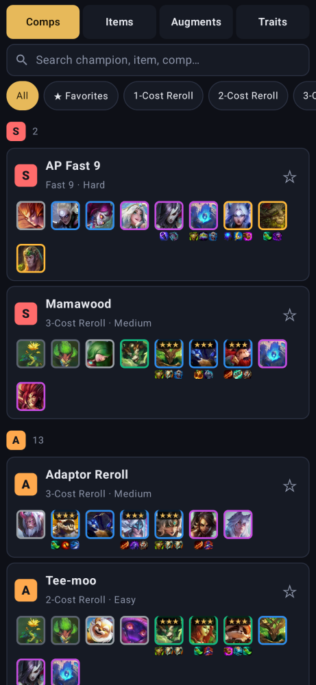
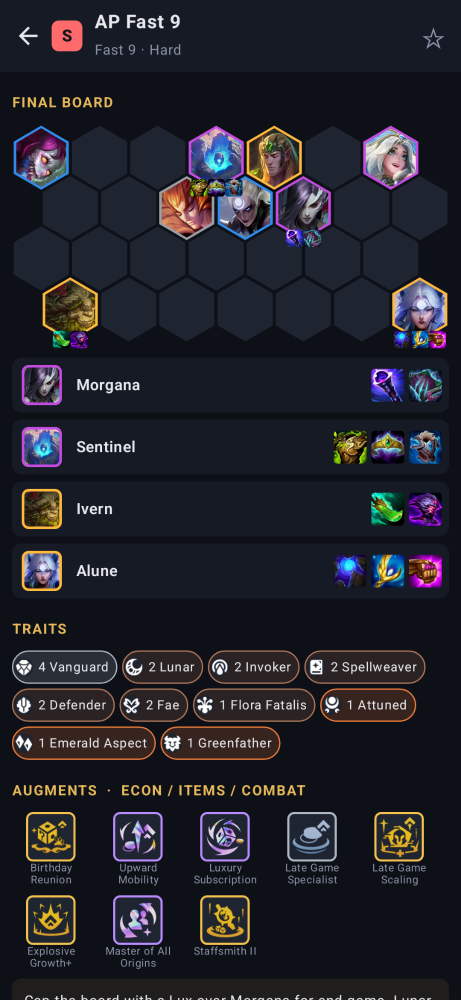
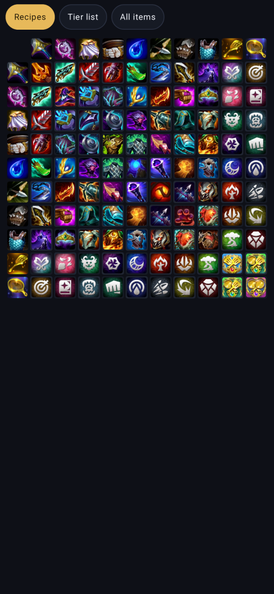
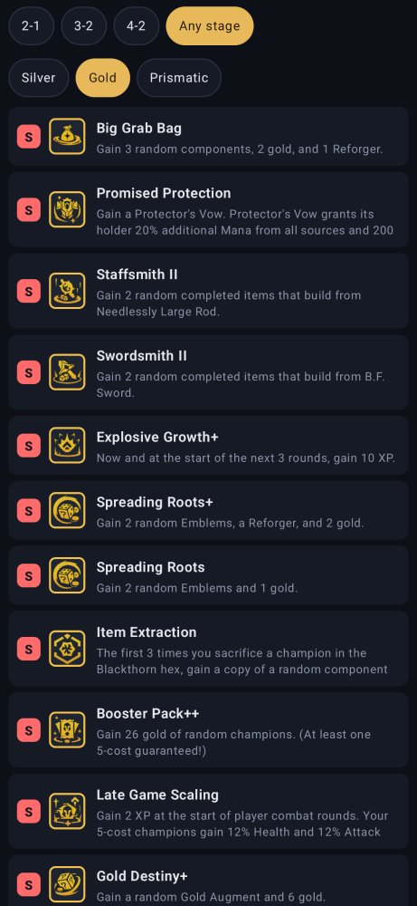

# Super TFT

App Android qui affiche les compos, items, augments et traits de **TFT Academy** dans une **bulle flottante par-dessus le jeu** (TFT mobile), avec mise à jour automatique des données et de l'app.

| Compos | Fiche compo | Recettes | Augments |
|---|---|---|---|
|  |  |  |  |

## Fonctionnalités

- **Tier list des compos** (S/A/B/C/X), filtres par style (Fast 8, Reroll…) et **favoris** ★
- **Fiche compo** : plateau hexagonal avec placement et items, carries, traits actifs calculés, augments conseillés, priorité carrousel, early game, unités à monter, améliorations de fin de partie, conseils par étape
- **Items** : matrice des recettes (composant × composant), tier list (items, radiants, artéfacts, emblèmes), liste complète
- **Augments** : tier list par étape (2-1, 3-2, 4-2) et par rareté (argent/or/prismatique)
- **Traits** : paliers, effets, champions
- **Recherche** globale (champion, item, augment, compo)
- **Overlay** : bulle déplaçable au-dessus du jeu → panneau compact (colonne latérale en paysage). Glisser la bulle vers la croix en bas pour la fermer. Opacité réglable.
- Interface **FR / EN** (données de jeu en anglais, comme sur TFT Academy)
- **Auto-update** des données (toutes les 3 h) et de l'app (GitHub Releases)

## Installation sur le téléphone

1. Ouvre la page [Releases](https://github.com/Amnyle/Super_TFT/releases/latest) sur ton téléphone et télécharge `SuperTFT-vX.Y.Z.apk`.
2. Ouvre l'APK et autorise l'installation depuis cette source si Android le demande.
3. Lance Super TFT → **Lancer l'overlay** → autorise « Afficher par-dessus les autres applis ».
4. Ouvre TFT : la bulle est là.

Les mises à jour suivantes se font depuis l'app (bannière « Version X disponible » → **Mettre à jour**). La première fois, Android demande d'autoriser Super TFT à installer des applis.

## Comment ça marche

```
tftacademy.com/api/...  ──(GitHub Action toutes les 3 h)──►  branche "data" : tft.json
                                                                   │
                     app Android ◄──── raw.githubusercontent.com ──┘   (cache local + snapshot dans l'APK)

tag vX.Y.Z  ──(GitHub Action)──►  APK signé dans GitHub Releases  ──►  auto-updater de l'app
```

- `scraper/fetch_tft_academy.py` : lit l'API publique de TFT Academy (`/api/tierlist/*`, `/api/assets/*`) et écrit un JSON compact. Les guides non publics sont ignorés. Si le site change, on corrige ce script sans republier l'APK.
- `.github/workflows/data.yml` : lance le script toutes les 3 h et publie `tft.json` sur la branche `data` seulement si le contenu a changé.
- `.github/workflows/release.yml` : à chaque tag `v*.*.*`, compile l'APK signé (avec un snapshot frais des données) et crée la Release.
- `.github/workflows/ci.yml` : compile et teste à chaque push.
- Les icônes viennent de `assets.tftacademy.com` et sont mises en cache sur le téléphone (80 Mo max).

## Publier une nouvelle version

1. **Une seule fois** : ajouter les 4 secrets de signature dans *Settings → Secrets and variables → Actions* : `SIGNING_KEYSTORE_BASE64`, `SIGNING_STORE_PASSWORD`, `SIGNING_KEY_ALIAS`, `SIGNING_KEY_PASSWORD`. **Garde le fichier `.jks` et le mot de passe** : sans la même clé, les mises à jour ne s'installent plus par-dessus.
2. Onglet **Actions** → **Release APK** → **Run workflow** → taper la version (ex. `1.0.2`). Le workflow crée le tag `v1.0.2`, compile et publie la Release.

   Ou, en ligne de commande, pousser un tag :

```bash
git tag v1.0.2
```

```bash
git push origin v1.0.2
```

L'app installée détecte la nouvelle Release au prochain lancement.

## Développement

Prérequis : JDK 17+, Android SDK (platform 35). Le code est en Kotlin + Jetpack Compose (minSdk 26).

```bash
python3 scraper/fetch_tft_academy.py app/src/main/assets/tft.json
```

```bash
./gradlew assembleDebug testDebugUnitTest
```

`testDebugUnitTest` lance aussi `OverlayTest` (Robolectric) : il démarre le vrai service d'overlay, touche la bulle puis les onglets du panneau.

Captures d'écran (Paparazzi, rendu JVM sans émulateur, à lancer séparément car incompatible avec Robolectric) :

```bash
./gradlew recordPaparazziDebug -Pscreenshots
```

Pour signer en local, créer `keystore.properties` à la racine (ignoré par git) avec `storeFile`, `storePassword`, `keyAlias` et `keyPassword`.

| Dossier | Rôle |
|---|---|
| `app/.../data` | modèles, chargement/cache/rafraîchissement, préférences |
| `app/.../overlay` | service de bulle + panneau flottant (WindowManager) |
| `app/.../update` | auto-updater GitHub Releases + PackageInstaller |
| `app/.../ui` | écrans Compose partagés par l'app et l'overlay |

## Mentions

Données et images : [TFT Academy](https://tftacademy.com). Projet personnel non affilié à TFT Academy ni à Riot Games. Teamfight Tactics est une marque de Riot Games. À utiliser pour soi et ses amis ; pour une diffusion publique, il faut l'accord de TFT Academy.
